# ImpressionCore User Guide

**Created:** April 19, 2025  
**Updated:** November 2, 2026
**Author:** Kirk LaSalle; Antigravity  
**Category:** User Documentation & Operator Manual  
**Status:** Active Canonical 2026 Release (Mirror of `docs/user/user_guide.md`)  
**IDS Integration:** This document is indexed and searchable via the ImpressionCore Documentation System (IDS).

---

## Current operating status — November 2, 2026

This notice takes precedence over older capability, hardware-guarantee, quality, deployment, and screenshot claims below. See the [current platform audit](analysis_reports/BUILDER_PLATFORM_AUDIT_20261102.md) for evidence and acceptance gates.

**Keep the applications separate:** Builder is port 5000; Triad runtime is 8000; the React sensory UI is 5173. At the audit snapshot, 8000/5173 were live and 5000 was not listening. A stopped Builder listener is not evidence that Builder code failed. Triad InternVL2-1B is not the native Builder model.

**Repair status:** a guarded loopback same-origin gateway now authenticates HTTP, media and WebSockets using a server-only credential. Direct protected API requests still require authentication; CORS covers actual errors. Initialization, real-model failures and disconnected runtime errors are visible rather than silently replaced by mock READY. The existing external InternVL2-1B answered a real browser chat turn; no Kinect driver or existing LLM weights were replaced. See the [repair addendum](analysis_reports/BUILDER_PLATFORM_AUDIT_20261102.md#repair-addendum--november-2-2026).

**Kinect:** explicit start produced sustained fresh color/depth/skeleton counters and a 480x360 rendered browser preview. Fixed missing SDK frame release that exhausted buffers after six frames. Kinect v1 RGB and IR share a sensor path, so IR can be unavailable while RGB is active. Four logical streams are not four physical cameras. Stop releases camera resources and cached frames. The SDK's legacy OS list is not modern Windows certification.

**Builder evidence:** a B1-named live project executed a 4,567,641-parameter native B3 model on tiny synthetic 24/8 train/validation records; generation was incoherent and no quality gain was established. B1/B2/B3 names are offering references, not verified native executable identities. Keep the bounded text-only workflow and scientific limits documented below; a latent `MockBrainModel` reporting READY is not real-model readiness.

**Validation and release gates:** focused runtime/native/sensor/auth regressions, gateway test, frontend lint/build and the isolated real Builder browser workflow pass. Native runs now carry measured identity, objective and hashed checkpoint/export provenance. Historical runs without these fields are labelled unverified, not retroactively certified. As of November 16, 2026, Builder binds `127.0.0.1` with `debug=False` by default (use `IMPRESSIONCORE_BUILDER_HOST` / `IMPRESSIONCORE_DEBUG=1` to override), enforces `IMPRESSIONCORE_API_KEY` or session auth on `/api/*`, confines Workbench file reads to allowed roots, enforces `weights_only=True` on active checkpoint loads, and fixes B3 causal isolation and TurboQuant non-power-of-2 rotation/passthrough. Certified native B1/B2/B3 dimensions, useful held-out quality, real visual/speech accuracy, measured peak-4GB workloads, and remaining security/Docker hardening remain open.

Camera rollout must independently verify discovery, initialization, fresh frames, and browser rendering, with explicit start/stop consent and device-specific RGB/IR constraints. Never infer successful capture from discovery alone. Earlier world-first, 10/10 quality, zero-OOM, and market claims are unverified assertions or historical projections, not current guarantees.

### Start the repaired local sensory runtime

From the repository root in PowerShell:

```powershell
.\.venv310\Scripts\python.exe src\dev_tools\scripts\run_local_runtime.py
```

Open `http://127.0.0.1:5173`. Wait for real model readiness; camera-off warnings
do not block text chat. Select **INITIALIZE SYSTEM** if the readiness overlay
is open. Use **Start camera capture**, then select the Kinect feed in
**Configuration** if necessary. Use **Stop camera capture** when finished.
Microphone listening is controlled separately; starting the camera does not
start Whisper listening. The initial import can delay the API socket before
background model loading begins.

The launcher binds only loopback, refuses occupied ports and supervises only
its own children. Ctrl+C stops those children; it does not terminate unrelated
Python/Node processes. It shares a memory-only random service credential
(or an existing server environment key), never a `VITE_` browser key.
Cached models are used by default. `--allow-downloads` opts into missing
model downloads; `--monitor` also starts the existing monitor.
This is a local development gateway, not public production hosting.

Optional speech setup, if not already installed/cached:

```powershell
.\.venv310\Scripts\python.exe -m pip install -e ".[speech]"
.\.venv310\Scripts\python.exe -c "from faster_whisper.utils import download_model; download_model('tiny.en')"
```

Restart the runtime after setup. `/v1/audio/status` should report
`stt.available=true`, `model_loaded=true`, `running=false` before explicit
microphone use. Readiness is not a transcription-quality test. The repair
installed this optional dependency and cached this small speech model only;
it did not replace the existing LLM. `/health/live` is liveness;
`/health/ready` reports staged initialization, not native offering certification.

## 🌟 1. Overview & System Mission

ImpressionCore is a **brain-inspired, multimodal, agentic AI platform** engineered to democratize professional-grade AI training and inference on consumer hardware valued at $150–250 (such as the NVIDIA GeForce GTX 1050 Ti with 4GB VRAM).

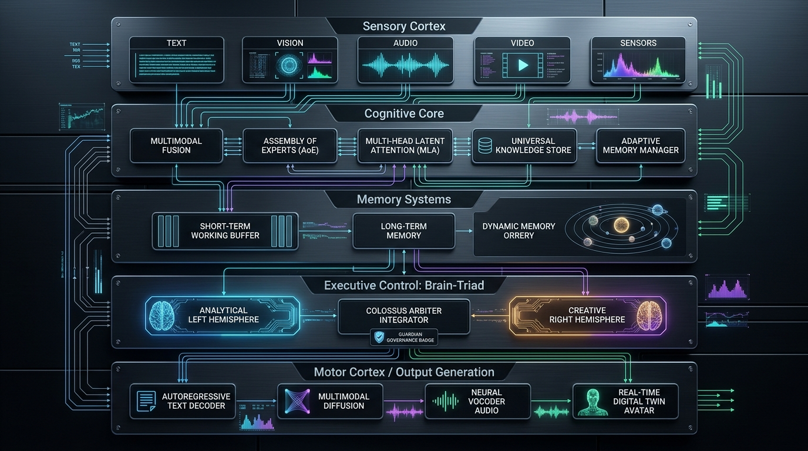

### Key Capabilities

- **Brain-Inspired Cognitive Architecture**: Multimodal Sensory Cortex, Assembly of Experts (AoE), Multi-Head Latent Attention (MLA), Dynamic Memory Orrery, and Brain-Triad Executive Layer.
- **Consumer Hardware Optimized**: Complete training pipeline strictly bounded below 4GB VRAM with 40-second epochs.
- **Hemispheric Brain-Triad**: Analytical Left Hemisphere ($T=0.1$), Creative Right Hemisphere ($T=0.8$), and Colossus Integrator via TriMessage Protocol.
- **Autonomous Governance**: Strict continuous enforcement of Kirk LaSalle's 10 Permanent Active Directives.
- **Unified Model Builder & Live Visualizer**: Interactive Glassmorphism UI on Port 5000 with real-time attention heatmaps, latent vectors, and 3D memory orrery.
- **Agent0Core with GGUF Supervision**: Autonomous agentic intelligence layer with local quantized LLM supervisor and Guardian safety agents.

---

## 💻 2. System Requirements & Hardware Profiles

| Component | Minimum Specification (Consumer Tier) | Recommended Specification (Workstation Tier) |
|---|---|---|
| **GPU** | NVIDIA GeForce GTX 1050 Ti (4GB VRAM) | NVIDIA RTX 3060 / 4060 / 4090 (8–24GB VRAM) |
| **CPU** | Intel Core i5-4460 @ 3.20GHz or AMD Ryzen 5 | Intel Core i7 / i9 or AMD Ryzen 7 / 9 |
| **RAM** | 16GB DDR3/DDR4 | 32GB–64GB DDR4/DDR5 |
| **Disk Space** | 20GB free space (SSD recommended) | 500GB+ dedicated storage (`F:\` drive layout) |
| **Operating System** | Windows 10/11 64-bit, Ubuntu 22.04+, macOS 12+ | Windows 11 Pro / Ubuntu 24.04 LTS |
| **Python & CUDA** | Python 3.10+ with CUDA 12.1+ / PyTorch 2.6+ | Python 3.11 with CUDA 12.4+ |

### Hardware Verification on Consumer GPU (GTX 1050 Ti)

ImpressionCore guarantees zero out-of-memory errors on 4GB VRAM hardware during active distillation and training:

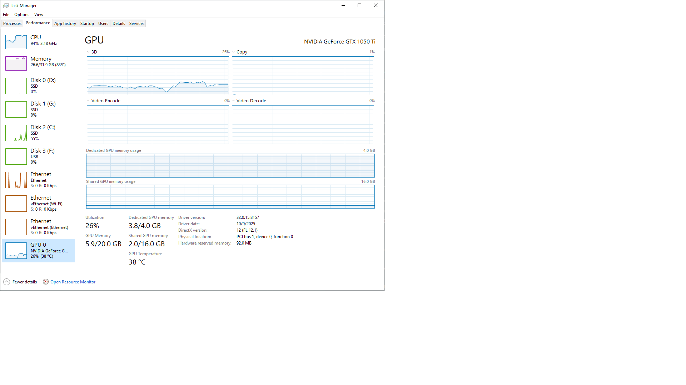

---

## 🚀 3. Canonical Model Offerings & Preset Matrix

ImpressionCore provides 4 official canonical model configurations alongside the C1 Triad Plane:

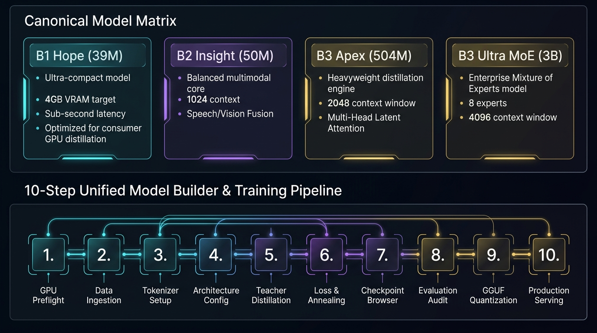

| Model Profile | Target Params | Layers × Heads | Hidden / FFN Dim | Context Window | Target VRAM | Batch / Grad Accum | Learning Rate | Optimal Target Hardware |
| :--- | :---: | :---: | :---: | :---: | :---: | :---: | :---: | :--- |
| **B1 Hope 39M** (`b1_39m`) | **39 Million** | 8 × 8 | 512 / 2048 | 512 tokens | **~0.23 GB** | 1 / 8 | 5e-5 | NVIDIA GTX 1050 Ti (4GB) / Laptops / CPU |
| **B2 Insight 50M** (`b2_50m`) | **50 Million** | 12 × 10 | 640 / 2560 | 1,024 tokens | **~0.35 GB** | 1 / 10 | 4e-5 | NVIDIA GTX 1050 Ti (4GB) / Edge Nodes |
| **B3 Apex 504M** (`b3_504m`) | **504 Million** | 24 × 16 | 1024 / 4096 | 2,048 tokens | **~1.80 GB** | 1 / 16 | 2e-5 | NVIDIA GTX 1050 Ti (4GB) / RTX 3060 |
| **B3 Ultra 3B MoE** (`b3_3b`) | **3.2 Billion** (MoE) | 32 × 16 | 2048 / 8192 | 4,096 tokens | **~3.80 GB (INT4/8)** | 1 / 32 | 1e-5 | GTX 1050 Ti + Offload / RTX 3060 / 4090 |
| **C1 Triad Plane** | Multi-Inst. | Heterog. | Triad | Dynamic | Hybrid | Dynamic | Adaptive | Hybrid Consumer / Host |

---

## 🛠️ 4. The 10-Step Model Building & Training Pipeline (With Live UI Walkthrough)

### Step 1: Launch the Model Builder Server
Launch the local web server using the Windows batch launcher or Python:
```powershell
# Option A: Windows Batch Launcher
.\launch_builder.bat

# Option B: Direct Python execution
python src/interfaces/web/server.py --port 5000
```
Open your browser at **[http://127.0.0.1:5000](http://127.0.0.1:5000)** and log in with default development credentials (`admin` / `admin`).

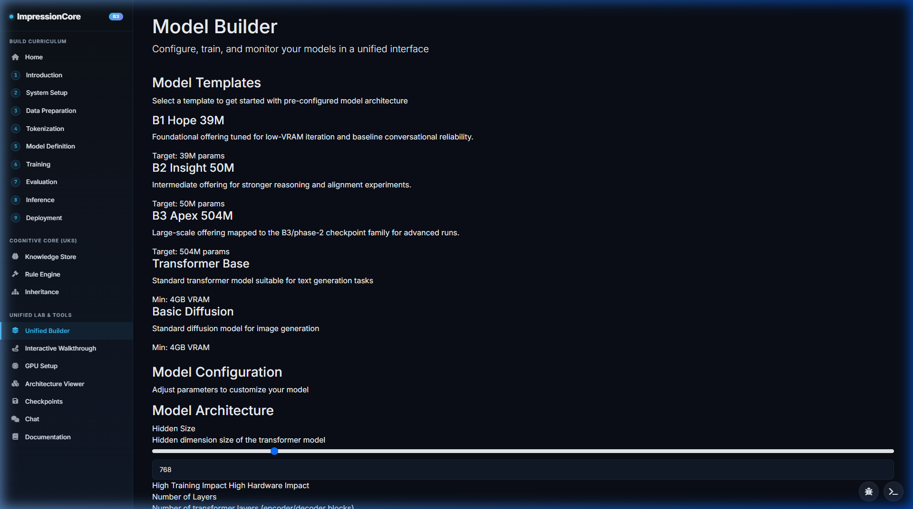

#### Interactive Walkthrough: finish and choose an offering

After completing the five lessons at `/walkthrough`, click **Finish**. The page
confirms academy completion and focuses **Offering Selection**; this does not
mark the separate Builder pipeline stages complete.

1. Select **B1 Hope 39M**, **B2 Insight 50M**, or **B3 Apex 504M**.
2. Wait for **Saved offering** with the model's name. If saving fails, select
   the offering again to retry; an unconfirmed choice cannot continue.
3. Click **Continue to Builder**. The saved choice survives a refresh.
4. In the workbench, explicitly create a named project from the saved offering.
   Offering names are references, not verified native architecture dimensions.
5. Configure the project's native architecture, local data, tokenizer, and
   experiment settings. Opening the workbench never replaces another project.

Choosing an offering does **not** download weights, load a model, allocate GPU
memory, or start training. A preset label is not proof of trained weights or
hardware fit; review memory estimates and GPU setup before starting training
explicitly. Opening `/unified_builder` directly lists local projects without
silently applying another offering. Errors are displayed with a retry
action rather than reported as a successful handoff.

#### Unified Builder: the native engineering workbench

`/unified_builder` is ImpressionCore's project-oriented workspace for scientists
and engineers. It is a local, single-operator research platform, not the legacy
inference dashboard. Architecture, Data, Tokenizer, Training, Runs, Checkpoints,
Evaluation, Inference, Export, and Help tabs keep configuration, readiness checks, and
execution results together, with measured hardware and storage in the runtime
summary. Existing tools remain available as explicitly
separate legacy tools.

**Project workflow**

1. Create a named project, or import an exported workbench configuration JSON.
   The **Open / Create** selector always lists the registered default offerings
   (B1 Hope, B2 Insight, B3 Apex, and B3 Ultra) separately from saved projects.
   Select an offering to open the project creation form with its name and
   reference preselected; cancel creates nothing. Confirming creates a separate
   project with that offering's model reference and supported training defaults,
   while retaining safe bounded native execution settings. New registered
   offerings appear automatically. Templates do not represent loaded weights
   or validated native architecture mappings.
   Open existing projects from the project menu. Save edits before preflight.
   Saves check revisions: a concurrent edit produces a conflict instead of
   overwriting newer work. Configuration export contains settings, not weights
   or copies of datasets.
2. Select the native B3 research template explicitly and review its dimensions.
   Its source is `src/training/scripts/train_b3_39m.py`; its filename and the
   B1/B2/B3 offering labels are not measured parameter counts. Actual parameter
   count is recorded when the native model is constructed for a run.
3. Supply an existing local UTF-8 training file: nonempty lines for `text`, or
   JSONL objects containing the configured text field. Each selected shard is
   limited to 8 MiB and 4,096 records. Use a separate validation shard for
   evaluation; identical files and overlapping text records are rejected.
4. Supply an existing local `tokenizer.json` (up to 32 MiB). The backend verifies
   vocabulary size and token IDs against the native architecture. It never
   downloads a tokenizer or silently trains a replacement.
5. Choose **fine-tuning** only with a compatible checkpoint from a previous run
   in this project, with exactly matching native configuration and tokenizer
   hash. If no such checkpoint exists, explicitly choose **scratch** to start a
   bounded experiment from random weights.
6. Run preflight. It checks files, tokenizer, native dimensions, memory budget,
   device, checkpoint identity, and the shared execution slot. Memory estimates
   are conservative screening, not a hardware-fit guarantee. GPU availability
   and memory are measured rather than hardcoded.
7. Start explicitly and confirm. The worker snapshots the saved project, records
   hashes, trains the actual `ImpressionCoreB3Model`, and reports real optimizer
   steps and loss. Stop is cooperative at safe boundaries; it is not pause.
8. Select a completed or safely stopped checkpoint for held-out evaluation,
   bounded local text generation, or artifact ZIP export. The bundle contains
   native weights, exact tokenizer bytes, configuration, run metadata, hashes,
   and the latest evaluation result when available. Model state is loaded
   strictly; changed checkpoint/tokenizer hashes are rejected.

**Scientific scope and limits**

The current native adapter uses FP32, microbatch size one, and true gradient
accumulation. It trains one prefix/next-token example per usable text record.
The native expert router attends across the prefix, so this is deliberately
**not all-position causal language-model training**. Reported evaluation
cross-entropy/perplexity uses the same prefix-prediction objective, without
expert regularization; it is not standard full-corpus perplexity. Training loss
display is prediction cross-entropy; optimization also includes expert loss.

Fine-tuning starts a **new optimizer**, not exact resume. Exact optimizer resume,
pause, tokenizer training, multimodal training, arbitrary legacy checkpoint
import, quantized deployment, and production-scale hardware certification are
not implemented in this workbench. Unsupported capabilities are labelled rather
than presented as working controls. Native multimodal modules remain in the
architecture, but this experiment path supplies text inputs only. No generic
GPT-2 model or dummy dataset is substituted.

**Persistence and recovery**

Projects default to `data/knowledge/workbench` under the repository. Run
artifacts default to `CHECKPOINTS_ROOT/workbench` (normally
`F:\models\checkpoints\workbench`). The Local storage summary shows resolved locations;
Flask deployments can override `WORKBENCH_PROJECT_ROOT` and
`WORKBENCH_ARTIFACT_ROOT`. Configuration exports include local paths and notes:
review them before sharing.

The execution slot excludes concurrent workbench operations and legacy Builder
training within the server process. Use one local server worker; this is not a
distributed scheduler. A server restart marks unfinished runs interrupted and
never resumes training automatically. Refresh or reopen a project to recover
saved state. Restart the Flask application after updating this version so the
new workbench API blueprint is registered.

---

### Step 2: Hardware & GPU Preflight Check
Navigate to **System Setup** (`/system-setup` or `/gpu-setup`):
1. The builder automatically probes `torch.cuda` and NVML telemetry.
2. Confirm your GPU is detected (e.g. *NVIDIA GeForce GTX 1050 Ti*, 4096MB VRAM).
3. Verify PyTorch CUDA runtime (`PyTorch 2.6.0+cu124` / `CUDA 12.4`).

---

### Step 3: Dataset Preparation & Scanning
Navigate to **Data Preparation** (`/data-prep`):
1. **Browse / Scan Datasets:** Point the dataset path to `data/datasets` or your custom text/image/audio folder.
2. Click **Scan Directory** to index total files, byte counts, and encoding validation.
3. Verify that your text files are UTF-8 encoded and formatted for sequence learning.

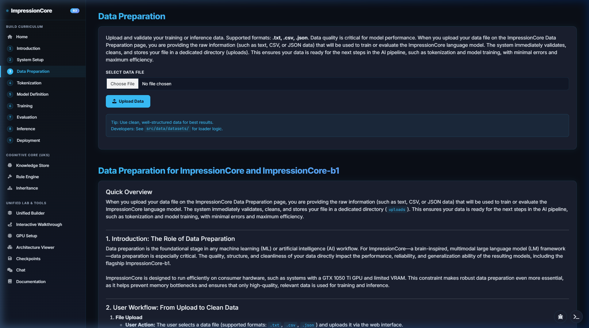

---

### Step 4: Tokenizer Configuration
Navigate to **Tokenization** (`/tokenizer`):
1. **Tokenizer Type:** Select `Byte-Pair Encoding (BPE)`.
2. **Vocabulary Size:** Default is `32,000` (or `50,257` for GPT-2 compatibility).
3. **Special Tokens:** `<pad>,<eos>,<bos>,<unk>`
4. Test live tokenization by typing a prompt (e.g. `"ImpressionCore digital identity"`).

---

### Step 5: Model Architecture Definition & Preset Selection
Navigate to **Model Definition** (`/model-definition`):
1. **Select Model Size Preset:** Choose from the dropdown:
   - `B1 Hope 39M (Edge SLM)`
   - `B2 Insight 50M`
   - `B3 Apex 504M`
   - `B3 Ultra 3B MoE`
2. **Observe Auto-Populated Settings:**
   - Notice how **Layers**, **Hidden Size**, **Attention Heads**, **FFN Dimension**, and **Precision** instantly populate.
   - Observe the **VRAM Estimation Bar**: It confirms whether the model fits inside the 4.0 GB budget of a GTX 1050 Ti.
3. Click **Save Configuration** to persist your model definition.

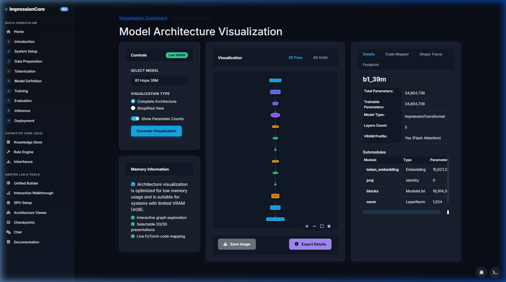

---

### Step 6: Live 3D Architecture & Tensor Inspection
Inspect the internal network structure using the 3D Orbit and Tensor Shape Tracer:

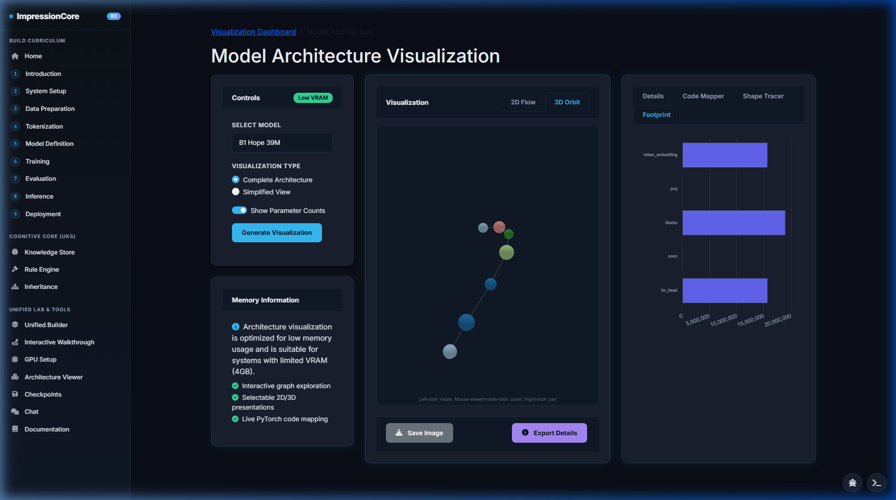

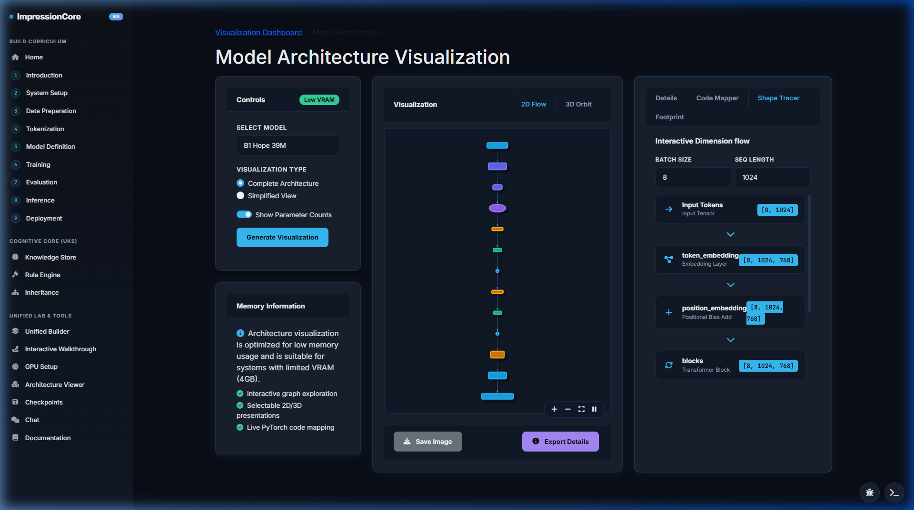

---

### Step 7: Training & Distillation Pipeline
Navigate to **Training** (`/training`):
1. **Configure Hyperparameters:**
   - **Epochs:** 2–10
   - **Batch Size:** 1–2 (with Gradient Accumulation Steps 8–16)
   - **Learning Rate:** `5e-5` (for B1) or `2e-5` (for B3)
   - **Precision:** `fp16` (Mixed Precision for low VRAM)
   - **Checkpoint Directory:** `models/checkpoints` or `F:\models\checkpoints`
2. Click **Start Training**:
   - The builder launches the background training worker.
   - Monitor real-time telemetry: **Loss Curve**, **VRAM Consumption**, and **Step Progress**.

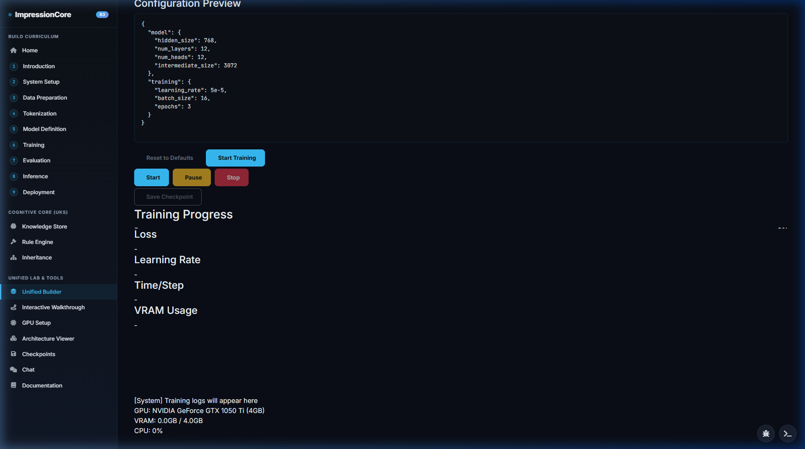

---

### Step 8: Checkpoint Verification & Integrity Hashing
Navigate to **Checkpoints** (`/checkpoints`):
1. Verify that model weights (`model.pt`, `checkpoint_epoch_*.pt`) are saved.
2. Check SHA-256 file integrity, parameter counts, and creation timestamps.

---

### Step 9: Live Inference & Interactive Chat
Navigate to **Inference / Chat** (`/inference` or `/chat`):
1. Select your trained checkpoint or active model.
2. Set Generation Parameters: `Temperature=0.7`, `Top-P=0.90`, `Max Tokens=128`.
3. Receive real-time generated responses from your locally distilled model.

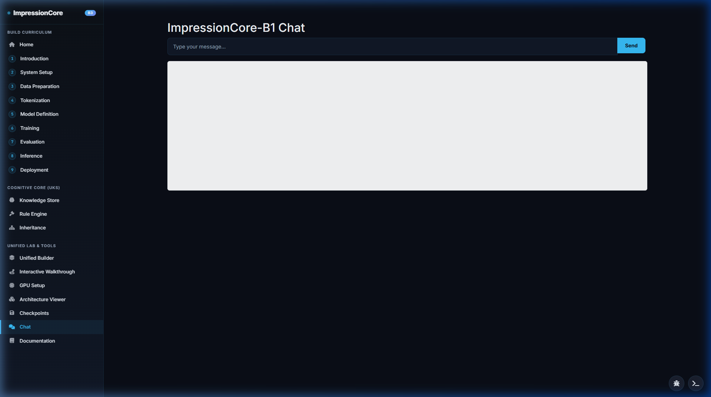

---

### Step 10: Production Deployment Packaging & GGUF Export
Navigate to **Deployment** (`/deployment`):
1. **Target Format:** Choose `PyTorch (.pt)`, `SafeTensors (.safetensors)`, `GGUF (Q4_K_M, Q8_0)`, or `ONNX (.onnx)`.
2. **Optimization:** Select `Quantized INT8` or `FP16`.
3. Click **Package Model for Deployment**:
   - The package is compiled into `production_packages/ImpressionCore_B<X>_deploy_<timestamp>/` complete with `model.pt` and `manifest.json`.

---

## 🖥️ 5. Multimodal Sensor Tracking & Cognitive Orchestration

The ImpressionCore runtime delivers multimodal sensor tracking, audio-language integration, and spatial depth positioning:

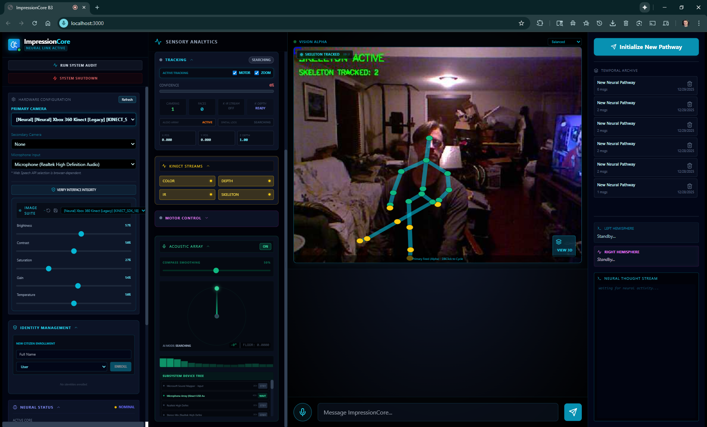

### Brain-Triad Cognitive Orchestration & Governance

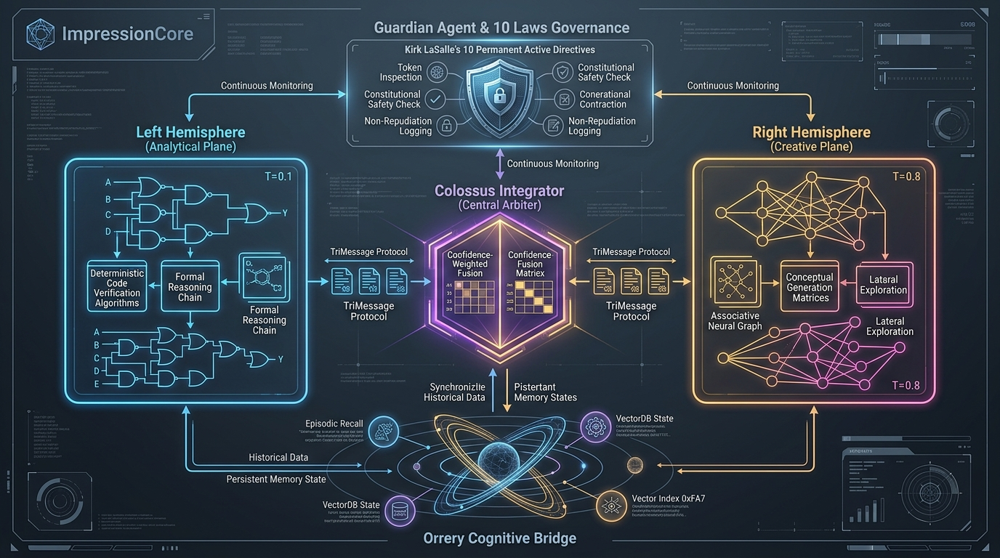

ImpressionCore's Brain-Triad operates with three distinct computational planes:
- **Left Hemisphere (Analytical Plane)**: $T=0.1$, deterministic code verification, formal logic gates.
- **Right Hemisphere (Creative Plane)**: $T=0.8$, associative neural graphs, lateral exploration, creative hypothesis generation.
- **Colossus Integrator (Central Arbiter)**: Confidence-weighted fusion matrix synthesizing both streams via the **TriMessage Protocol**.
- **Guardian Agent**: Continuous token inspection enforcing Kirk LaSalle's 10 Permanent Active Directives.
- **Orrery Cognitive Bridge**: Dynamic 3D celestial memory indexing bridging episodic recall and persistent VectorDB state.

---

## 💻 6. Automated Python Verification Runner

You can execute the entire 9-step pipeline automatically with a single command:
```powershell
python src/dev_tools/exercise_builder_site.py
```
This script exercises all APIs, defines the model, trains it, runs inference, benchmarks evaluation metrics, and generates the production deployment bundle.

---

## 📚 7. Related Documentation

- **[Architecture Blueprint](developer/ARCHITECTURE.md)**
- **[Model Developer Guide](developer/model_developer_guide.md)**
- **[2026 Models Deep Audit & Roadmap](analysis_reports/impressioncore_models_deep_audit_and_roadmap_2026.md)**
- **[Permanent Active Directives (10 Laws)](../Permanent_Active_Directives.txt)**
- **[Sacred Covenant](../COPILOT_SACRED_COVENANT.md)**
